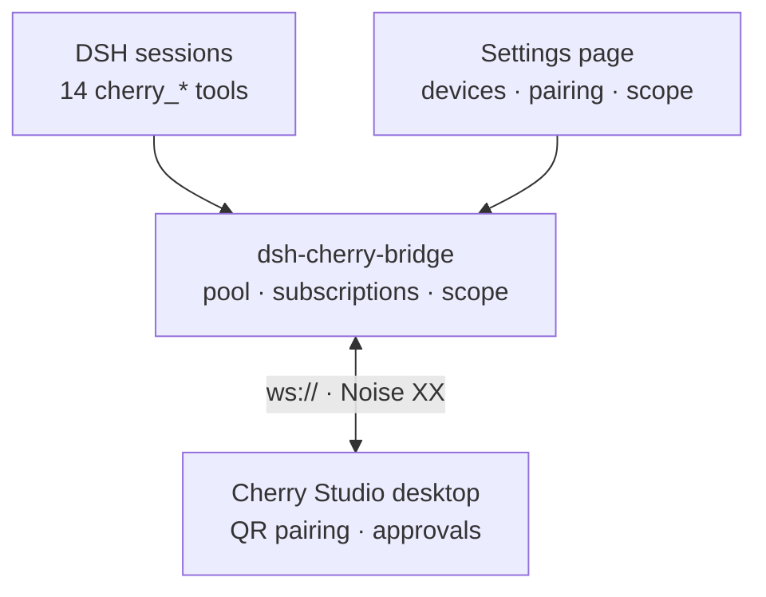

<div align="center">

**English** | [简体中文](README.md)

</div>

<div align="center">


</div>

# dsh-cherry-bridge

**Bridge DeepSeek Harness to Cherry Studio desktops** — a DSH plugin

Drive Cherry Studio agents on your LAN straight from a DSH session: pair, list
devices/sessions, read history, send messages and wait for a terminal state,
answer approval and question cards, cancel executions — plus a same-origin
settings page for device and tool-scope management.



- Package: `dsh-cherry-bridge`, plugin id: `cherry-remote`
- Transport: `ws://` + Noise XX (encryption lives in the Noise record layer; no TLS termination required)
- Tool face: 14 `cherry_*` tools, enabled **per workspace**, and by default **nobody has them** (see “Scope”)
- Settings page and HTTP face: the same-origin prefix `/cherry-remote/api` on the host web server

## Install

> **DSH version requirement**: `>=0.2.0-rc.2 <0.3.0-0` (declared via `engines.dsh` in `package.json`; when unmet the bundle is skipped and its settings-page row disabled — `dsh plugin allow-version` grants an explicit exemption; 0.3.0 needs a fresh compatibility pass before the range widens).

```bash
# From GitHub (recommended)
npx @deepseek-ai/dsh plugin --profile web add github:SAXEM1997/dsh-cherry-bridge

# Pinned to a version tag (recommended for production)
npx @deepseek-ai/dsh plugin --profile web add github:SAXEM1997/dsh-cherry-bridge#v0.1.4

# Or from the npm registry
dsh plugin --profile <name> add dsh-cherry-bridge
```

The package ships `cordis.patch.yml` (`package.json`'s `dsh.bundle.patch` points
at it); dsh-plugin-manager inserts the plugin line from it. The manual profile
line is equivalent to:

```yaml
- id: cherry-remote
  name: 'dsh-cherry-bridge'
  config:
    perSessionCacheBytes: 2097152
    rateBudgetPerSecond: 32
```

### First pairing

1. On the Cherry Studio desktop open **remote access → add device**: that
   screen shows a **QR code**; the pairing information only appears on the page
   the code leads to.
2. **Scan the QR code** (WeChat, any browser, …) and copy the pairing
   information the scanned page displays.
3. In DSH call `cherry_pair` (the settings-page wizard works too) and paste it.
4. **Cross-check the 6-digit verification code both ways** against the
   desktop's number before approving on the desktop side.
5. After approval the device archive is written to the data directory
   (`devices.json`, `0600`) with the `desktopIdentity` **pinned**; every later
   connection verifies the Noise peer static key against the pin, so a hijacked
   QR code cannot be traded for a man-in-the-middle substitute.

## Quick start

```text
cherry_pair → paste the pairing info from the scanned page, check the 6-digit code
cherry_devices → see devices and connection state (a prefix selects one, e.g. "dev-A")
cherry_agents → list the device's agents, take an agentId
cherry_sessions → list an agent's sessions, take a sessionId
cherry_read → read history (defaults to the newest 100, newest-first)
cherry_send → send a message and wait for the terminal state; returns the assistant text
cherry_interactions → see pending question/approval cards; cherry_respond answers them
```

## Configuration

| Key | Type | Default | Notes |
| --- | --- | --- | --- |
| `dataDir` | string | `$DSH_HOME/cherry-remote` (fallback `~/.dsh/cherry-remote`) | Plugin data directory holding `identity.key` and `devices.json` (both `0600`). |
| `perSessionCacheBytes` | number | `2097152` (2 MiB) | Per-session cap on the **local** subscription event cache; beyond it the oldest events are dropped LRU-style with a `warn`. |
| `rateBudgetPerSecond` | number | `32` | Per-device smoothed request budget (req/s). The desktop's hard limit is 64 req/s with no negotiation channel; exceeding it terminates the session with close `1011` — hence the conservative value. |

> ⚠️ `cordis.patch.yml`'s `config` is **whole-replace**, not merged with the
> defaults. Removing a key gets you the plugin default; a key that exists but is
> unusable (`0`, negative, a string) falls back with a named `warn`.

## Tools

| Tool | What it does |
| --- | --- |
| `cherry_devices` | List every paired device and its connection state (`connected`/`connecting`/`offline`/`disabled`/`identity-mismatch`). |
| `cherry_agents` | List the agents available on a device (paginated). |
| `cherry_workspaces` | List an agent's **registered** workspaces, and whether a system workspace exists. |
| `cherry_sessions` | List an agent's sessions, optionally filtered by workspace. |
| `cherry_read` | Read a session's message history snapshot, **newest-first** (`limit` drops the **oldest** messages). Attachment parts come back as `name`/`mediaType`/`byteLength` with an empty `content` — the bytes are never fetched. A truncated walk always says so (`truncated` + `truncationReason`): `limit` means your own ceiling was reached and raising `limit` helps; `aggregate-bytes` means the answer hit its **output size limit** — independent of `limit` (a larger `limit` only costs more round trips and stops at the same budget). **The older messages are reached by the resume token**: pass the `messagesResumeCursor` a truncated answer returned as this tool's own `messagesResumeCursor` argument to continue from that stop point (`limit` then bounds how many messages come back **from there**), walking a long history in successive answers. Two token forms: `cursor:<peer position>` (the peer page position after a whole window was consumed) and `after:<messageId>` (the walk stopped inside its window; the resume scans from the newest end to that message and returns the older ones). A token this tool did not emit is **refused locally** (never forwarded — the desktop silently falls back to the newest page for one), and an `after:` anchor that is no longer in the history is an **error**, not an empty result. |
| `cherry_events` | Read the session's buffered events newer than `cursor`, acking them after delivery. |
| `cherry_create` | Create a session in an agent workspace (workspace selection is **required**; identity is read back). |
| `cherry_send` | Send a message, by default waiting for a terminal state and returning the assistant text; `wait: false` returns the command receipt immediately. `messagesTruncated`/`messagesTruncationReason` report a **message**-level cut (older messages dropped). |
| `cherry_wait` | Wait only for the session's in-flight execution to settle (sends nothing). |
| `cherry_interactions` | List the session's **pending** interaction cards (questions / approvals). |
| `cherry_respond` | Answer an interaction card: questions must be answered in full; approvals take `decision`. |
| `cherry_cancel` | Cancel the session's in-flight execution (`expectedExecutionId` required). |
| `cherry_pair` | Pair with a desktop using the pairing information shown by the scanned page. |
| `cherry_unpair` | Unpair: tear the connection down and delete the device archive entry. |

The `device` argument accepts an **exact `deviceId`**, or a **prefix of a
`deviceId` or of a display name**; several matches return `ambiguous-device` +
`candidates`, and no match returns `not-found` + `known`.

`cherry_send(wait: true)` / `cherry_wait` results carry one of **8 `status`
values**: the four protocol terminal states
(`completed`/`failed`/`cancelled`/`interrupted`), plus `awaiting-interaction`
(a pending card appeared while the run is still alive), `timeout` (the window ran
out, **not a failure** — partial content plus a stop-point cursor come back),
`idle` (`cherry_wait` met a session with nothing in flight and returned the
snapshot immediately), and `subscription-lost` (the subscription was lost and
could not be rebuilt, so the outcome is **unknowable**; repair guidance ships
with it).

## Errors and limits

- Read methods are replayed **once** after a reconnect; **commands are never
  replayed** — a write that loses its reply is recovered by retrying with the
  **original `commandId`**, and the desktop's command ledger replays the receipt.
- One externalized content is capped at 32 MiB; a larger part is marked
  `unavailable` rather than returning unverifiable partial content.
- A truncated history walk always says so (`truncationReason`; `limit` and
  `aggregate-bytes` mean different things, see above) and, whenever a stop point
  can be named honestly, carries a `messagesResumeCursor` resume token (absent
  when the walk reached the peer's last page); a message whose own parts could
  not be fully read carries `incomplete: true`.
- **Known limitations**: `cherry_respond` lets a DSH agent approve Cherry-side
  approval cards on the user's behalf (the MVP adds no interception layer and
  trusts DSH's own tool-call approvals); only the `agent` capability is
  requested per device; `ws://` only (Noise encryption), no direct TLS.

> Engineering detail — replay rules, the 32 MiB/≈3× memory contract, empty-page
> and cursor tolerance, integrity semantics — lives in [`AGENTS.md`](AGENTS.md).

## Settings page and scope

The plugin is also a **web client bundle** (`package.json`'s `dsh.client`,
exporting `./client`). Through the `settings.section` slot it registers a
**`cherry-remote`** page (nav label “Cherry Studio Bridge”): device cards
(enable/disable/remove), a pairing wizard (paste → 6-digit code → verdict), a
scope panel, and live state pushed over the same-origin SSE feed
(`/cherry-remote/api/events`).

The 14 tools appear **per workspace**, by **hiding, not refusing** (in an
out-of-scope session they never enter the tool table, saving context):

- **Default is nobody**: a missing, corrupt or unreadable scope document is
  treated as `selected` + an empty list (fail-closed).
- **`Selected workspaces only`**: only sessions inside ticked workspaces can see
  the tools; sessions with no workspace never do.
- **`Global`**: visible everywhere; the ticks play no part.
- **Saves take effect immediately**: the restriction layer is re-installed or
  released for every live agent, effective from the **next turn** — no restart,
  no new session.
- **Scope governs tools only**: the settings page and `/cherry-remote/api` are
  never scope-gated, so an excluded workspace can rescue itself.
- **No pretending**: on `pending` / `unsupported` host capability the panel says
  so and the tools stay **unregistered** (fail-closed).

For development run `npm run dev:ui` — a DSH host must already be running at
`http://127.0.0.1:23023`; override with
`CHERRY_DEV_HOST=http://127.0.0.1:<port> npm run dev:ui`. The scope document is
`<dataDir>/scope.json` (`0600`, atomic, monotonic `revision`); endpoints and
error codes are documented in [`AGENTS.md`](AGENTS.md).

## Development

```bash
npm test               # full vitest run (incl. tests/contract/)
npm run typecheck      # server + UI projects
npm run build          # tsdown → dist/index.mjs + dist/index.d.mts
npm run build:client   # vite → lib/client.js
npm run dev:ui         # settings-page dev server (host must run at 127.0.0.1:23023)
npm run prepublishOnly # pre-publish gate: typecheck + test + build + build:client
```

`dist/` and `lib/` are **committed** artifacts: after changing `src/` or `ui/`
re-run `npm run build && npm run build:client` before committing. Working
conventions, build facts, the protocol basis and the design decisions live in
[`AGENTS.md`](AGENTS.md); before a release, walk
[`docs/e2e-checklist.md`](docs/e2e-checklist.md) (pairing / send / interaction
answers / disconnect recovery / multi-device coexistence need a real device).

## License

MIT
