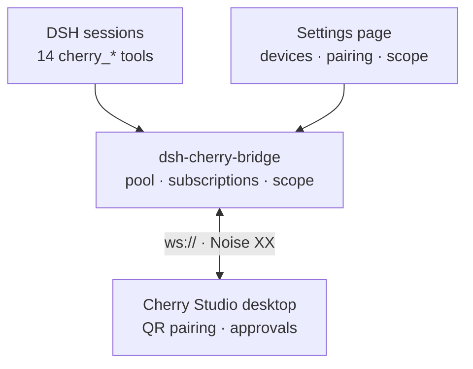

<div align="center">

**English** | [简体中文](README.md)

</div>

<div align="center">


</div>

# dsh-cherry-bridge

**Bridge DeepSeek Harness to Cherry Studio desktops** — a DSH plugin

Drive Cherry Studio agents on your LAN straight from a DSH session: pair, list
devices/sessions, read history, send messages and wait for a terminal state,
answer approval and question cards, cancel executions — plus a same-origin
settings page for device and tool-scope management.



- Package: `dsh-cherry-bridge`
- Plugin id: `cherry-remote` (echoing the `remoteDiscoveryType` mDNS service identity)
- Transport: `ws://` + Noise XX (encryption lives in the Noise record layer; no TLS termination required)
- Tool face: 14 `cherry_*` tools
- Scope: the 14 tools are enabled **per workspace**, and by default **nobody has them** (see “Scope” below)
- HTTP face: same-origin prefix `/cherry-remote/api` on the host web server

## Install

> **DSH version requirement**: `>=0.2.0-rc.2 <0.3.0-0` — declared via `engines.dsh` in `package.json`; DSH's plugin compatibility gate checks it, and when it is unmet the install/enable is refused (the bundle is skipped and its row disabled). `dsh plugin allow-version` grants a precise, explicit exemption if you really need one. 0.3.0 support needs a fresh compatibility pass before the range widens.

```bash
# From GitHub (recommended)
npx @deepseek-ai/dsh plugin --profile web add github:SAXEM1997/dsh-cherry-bridge

# Pinned to a version tag (recommended for production)
npx @deepseek-ai/dsh plugin --profile web add github:SAXEM1997/dsh-cherry-bridge#v0.1.3
```

```bash
# Or from the npm registry
dsh plugin --profile <name> add dsh-cherry-bridge
```

Alternatively merge it into a profile via a bundle patch — this package ships
`cordis.patch.yml` declaring the `cherry-remote` insertion line and its default
config (see “Configuration” below). `package.json`'s `dsh.bundle.patch` points
at that file; dsh-plugin-manager inserts the plugin line from it.

The manual profile line is equivalent to:

```yaml
- id: cherry-remote
  name: 'dsh-cherry-bridge'
  config:
    perSessionCacheBytes: 2097152
    rateBudgetPerSecond: 32
```

### First pairing

1. On the Cherry Studio desktop open **remote access → add device**: that
   screen shows a **QR code**; the pairing information (address, port, and the
   one-time invitation) only appears on the page the code leads to.
2. **Scan the QR code** (WeChat, any browser, …) and copy the pairing
   information the scanned page displays.
3. In DSH call `cherry_pair` (the settings-page wizard works too) and paste
   that pairing information.
4. **Cross-check the 6-digit verification code both ways**: `cherry_pair` and
   the settings page both display it prominently — compare it by eye against
   the desktop's number before approving on the desktop side.
5. After approval the device archive is written to the plugin data directory
   (`devices.json`, mode `0600`) with the `desktopIdentity` **pinned**; every
   later connection verifies the Noise peer static key against the pin, so a
   hijacked QR code cannot be traded for a man-in-the-middle substitute.

## Configuration

| Key | Type | Default | Notes |
| --- | --- | --- | --- |
| `dataDir` | string | `$DSH_HOME/cherry-remote` (fallback `~/.dsh/cherry-remote`) | Plugin data directory holding `identity.key` and `devices.json` (both `0600`). |
| `perSessionCacheBytes` | number | `2097152` (2 MiB) | Per-session cap on the **local** subscription event cache. Beyond it the oldest events are dropped LRU-style with a `warn`. |
| `rateBudgetPerSecond` | number | `32` | Per-device second-level smoothed request budget (req/s). The desktop's hard limit is 64 req/s with **no negotiation channel** (since 2.1.5 `agent.content.read` has its own 512 req/s window); exceeding it terminates the whole session with close `1011` — hence the conservative value. |

> ⚠️ `cordis.patch.yml`'s `config` is **whole-replace**, not merged with the
> bundle defaults. The assembly layer (`resolveBridgeConfig`) falls back to the
> defaults above for missing keys — removing a key gets you the **plugin
> default**, not some other value from the profile. A missing key and an
> invalid value are different things: a key that exists but is unusable (`0`,
> negative, a string) falls back with a named `warn`.

## Tools

| Tool | What it does |
| --- | --- |
| `cherry_devices` | List every paired device and its connection state (`connected`/`connecting`/`offline`/`disabled`/`identity-mismatch`). |
| `cherry_agents` | List the agents available on a device (paginated). |
| `cherry_workspaces` | List an agent's **registered** workspaces, and whether a system workspace exists. |
| `cherry_sessions` | List an agent's sessions, optionally filtered by workspace. |
| `cherry_read` | Read a session's message-history snapshot (two-level baseline: `agent.sessions.get` + `agent.messages.list`/`agent.parts.list`; parts are read under **each message's own** revision). Attachment parts come back as `name`/`mediaType`/`byteLength` with an **empty** `content` — the bytes are never fetched. Messages come back **newest-first** (`messages[0]` is the latest), so `limit` drops the **oldest** messages; a truncated walk always says so (`truncated` with a `truncationReason`), and `messagesResumeCursor` is a **stop-point marker only** — it flags that **older** messages are still unread, and it is not an argument this tool accepts (`cherry_read` has no cursor parameter); a `truncationReason` of `limit` is reached by raising `limit`, while `aggregate-bytes` is an **output-budget stop** (the answer hit its size limit, independent of `limit`: a larger `limit` only costs more round trips and still stops at the same budget), and the older messages it leaves out are then **unreachable through this tool by any argument** (the walk always starts at the newest message and takes no cursor) — view them on the desktop, or wait for the history-cursor read parameter a future release would add (tracked as #26; not provided today); message-walk truncation only ever drops the **older** messages and never cuts inside a **returned** message's parts (a circuit-broken parts walk is a different scope: `partsTruncated` drops that message's **later** parts). A message whose own parts could not be fully read (a part with `unavailable`, or a circuit-broken parts walk with `partsTruncated`) carries `incomplete: true`, plus an `unavailableParts` count when parts were unreadable — a content verdict on the message, unrelated to the walk. |
| `cherry_events` | Read the session's buffered events newer than `cursor`, acking them after delivery. |
| `cherry_create` | Create a session in an agent workspace (workspace selection is **required**; identity is read back via `agent.sessions.get`). |
| `cherry_send` | Send a message to a session, by default waiting for a terminal state and returning the assistant text; `wait: false` returns the command receipt immediately. When content is cut, `messagesTruncated`/`messagesTruncationReason` report a **message**-level cut (older messages dropped, a returned message never cut inside); a returned message missing its own parts carries `incomplete`. |
| `cherry_wait` | Wait only for the session's in-flight execution to settle (sends nothing). |
| `cherry_interactions` | List the session's **pending** interaction cards (questions / approvals). |
| `cherry_respond` | Answer an interaction card: questions must be answered in full; approvals take `decision`. |
| `cherry_cancel` | Cancel the session's in-flight execution (`expectedExecutionId` required). |
| `cherry_pair` | Pair with a desktop using "the pairing information shown by the scanned page". |
| `cherry_unpair` | Unpair: tear the connection down and delete the device archive entry. |

The device selector (the `device` argument) accepts an **exact `deviceId`**, or
a **prefix of a `deviceId` or of a display name** (both are matched together and
deduplicated by `deviceId`); a prefix matching several devices returns a
structured ambiguity error (`ambiguous-device` + `candidates`) — it never picks
one arbitrarily — and a selector matching nothing returns `not-found` + `known`
(the paired `deviceId`s), not an ambiguity with no candidates. `cherry_devices`
returns either verdict as its structured result; every other tool **throws**
when no device matches instead of returning a verdict object. A quarantined
archive (`archive-quarantined`) outranks all of this.

`cherry_send(wait: true)` / `cherry_wait` results carry one of **8 `status`
values**: the four protocol terminal states
(`completed`/`failed`/`cancelled`/`interrupted`) plus four waiter verdicts of
its own — `awaiting-interaction` (a soft terminal: a pending interaction card
appeared while the run is still alive), `timeout` (the window ran out,
**not a failure** — the partial content and a **stop-point cursor** come back:
it marks that older history is still unread, and it is not an input this tool
accepts; to see more, wait again or raise `limit` with `cherry_read`),
`idle` (`cherry_wait` met a session with nothing in flight and returned the
current snapshot immediately), and `subscription-lost` (the event subscription
was lost mid-wait and could not be rebuilt, so the outcome is **unknowable**
from here: unlike `timeout`, it ships guidance to repair the subscription or
re-read the run by id).

### Errors and recovery

- **Transport loss is handled differently for reads and for commands.** A read
  method is replayed **once**, at a fresh rate-limit admission, after a
  reconnect; a second loss or a torn-down connection lifecycle yields a
  structured lost error instead of an endless retry. A **command is never
  replayed**: when `cherry_send`/`cherry_create`/`cherry_respond`/
  `cherry_cancel` loses its answer, the caller retries with the **original
  `commandId`** — the desktop's command ledger replays the original receipt,
  and only the same id with a *different* body is reported as an idempotency
  conflict.
- **One ref's externalized content is capped at 32 MiB.** A part above the cap
  is marked `unavailable`, its message carries `incomplete: true`, and also an
  `unavailableParts` count when parts were unreadable; unverifiable partial
  content is never returned. The cap is **per ref**: assembling one content
  holds roughly 3x its size in memory, an aggregate reads refs sequentially
  (peak = one ref's 3x), but **concurrent reads multiply that peak by their
  number in flight**.
- **A list walk tolerates at most two consecutive empty transitional pages
  whose cursor advances, and refuses on the third** (the desktop's
  section-transition behaviour; any non-empty page resets the run). A cursor
  that does not advance, or one that loops back to a cursor already served, is
  refused outright rather than spun on.
- **Release gates divide the work:** `prepublishOnly` runs the whole chain
  (typecheck + full suite + both builds), while
  `tests/unit/artifactFreshness.test.ts` does the byte-for-byte comparison —
  rebuilding from the current source into a temp dir and passing only when the
  result is identical to the **committed** `dist/index.mjs`,
  `dist/index.d.mts` and `lib/client.js`.

## Settings page (web client)

The plugin is also a **web client bundle** (`package.json`'s `dsh.client`
declares `platform: web` and exports `./client`). It registers a
**`cherry-remote`** namespace page through the host settings page's
`settings.section` slot, providing:

- device cards: display name, addresses, connection state light,
  enable/disable, remove;
- a pairing wizard: paste the pairing information from the scanned page →
  show the 6-digit verification code → show the terminal verdict;
- a scope panel: `Global` / `Selected workspaces only` plus a workspace
  multi-select (title + path) — see “Scope” below;
- live state: device states and pairing progress stream over the same-origin
  SSE feed (`/cherry-remote/api/events`).

For development run `npm run dev:ui` (the Vite entry under `ui/`). **This
requires a DSH host already running at `http://127.0.0.1:23023`**: the dev
server serves only the page itself; the `/cherry-remote/api` calls it makes
are forwarded to the host by a **dev-only proxy** in `ui/vite.config.ts` (SSE
included, unbuffered). Without a host the page renders but the device list and
event stream error out. If the host lives on another port, override with
`CHERRY_DEV_HOST=http://127.0.0.1:<port> npm run dev:ui` — no code changes
needed.

## Scope

The 14 `cherry_*` tools appear **per workspace**, not in every session. The
settings page's **scope panel** (namespace `cherry-remote`, nav label
“Cherry Studio Bridge”) edits it. The mechanism is **hiding, not refusing**:
in an out-of-scope session the tools never enter the tool table (saving
context) rather than being visible-but-erroring.

- **Default is nobody**: when the scope document does not exist it is treated
  as `selected` + an **empty list** — **no workspace** gets the tools. That is
  the fail-closed side: a corrupt document, invalid fields, or an unreadable
  one all land on the stricter side; there is **no** "unreadable → treat as
  global" escape hatch.
- **`Selected workspaces only` (`selected`)**: only sessions inside ticked
  workspaces can ever see the tools; sessions with **no workspace** (whose
  `cwd` belongs to no registered workspace) never do (fail-closed).
- **`Global` (`global`)**: visible in every workspace; the ticks then play no
  part in the decision (they matter again after switching back to `selected`).
- **Saves take effect immediately, in running sessions too**: a successful
  save re-installs / releases the restriction layer for **every live agent**,
  effective from the **next turn** — no DSH restart, no new session; un-ticking
  likewise removes them from the next turn.
- **Scope governs tools only**: the settings page and `/cherry-remote/api`
  are **never** scope-gated — an excluded workspace must still be able to
  rescue itself (pair, change the scope).
- **No pretending when capability is missing**: while `host.state` is
  `pending` (the injection callback has not arrived) the panel shows a neutral
  wait note and does **not** disable save; when it is `unsupported` (any of
  `tools.register` / `tools.restrict` / `tools.schemas` statically missing) it
  shows a read-only warning naming the **real missing cause** and disables
  save. Under both states the tools stay **unregistered** (fail-closed) —
  never a fallback to "globally visible".

> **Wording boundary**: the panel only claims "this plugin does not shadow
> these tools". Upstream `allow`-shaped filtering (a sub-agent's
> `toolFilter`, for example) can still keep them out of a session — that is
> accepted behavior, and this plugin promises nothing about layers above it.

### The scope document and endpoints

The scope document lives in the plugin data directory:
`<dataDir>/scope.json` (default `$DSH_HOME/cherry-remote/scope.json`), mode
`0600`, written atomically, with a monotonically increasing `revision` — the
**single exception** being a document that fails to parse or has invalid
fields: it is rebuilt on the stricter side (`selected` + empty list) with
`revision` reset to 0, and the file remains writable; it deliberately does
**not** live in profile YAML (no second source of truth).

`GET /cherry-remote/api/scope` returns the whole state in one body:

```json
{
  "scope": { "mode": "selected", "workspaceIds": [], "revision": 0 },
  "workspaces": [{ "id": "…", "title": "…", "path": "…" }],
  "staleWorkspaceIds": [],
  "pathUnmatched": [{ "agentId": "…", "cwd": "…" }],
  "host": { "state": "ready", "capable": true, "reason": "…", "degraded": [] }
}
```

- `scope` — the document's three writable fields
  (`mode` / `workspaceIds` / `revision`).
- `workspaces` — the registry's workspaces (projected to `id`/`title`/`path`;
  the browser cannot reach the registry itself).
- `staleWorkspaceIds` — ids ticked in the document that the registry no longer
  has: a `PUT` prune is **the only path that clears them**; the UI reports the
  result via `pruned` instead of crying "validation failed".
- `pathUnmatched` — sessions whose **cwd does not match the current canonical
  path table** (`agentId` + `cwd`). Both kinds land here: a cwd that resolves
  but (after realpath normalization) belongs to no registered workspace (a
  spelling difference, a symlink, or a genuinely unregistered directory —
  indistinguishable here); and, when the host lacks `resolveByPath` (see the
  `path-normalization` source below), a cwd compared only by
  case-sensitive string equality that missed. They are treated as
  "workspace-less": under `selected` those sessions do not see the 14 tools;
  under `global` everything stays visible regardless of workspace
  registration, so this entry only explains "ticked but no tools" under
  `selected`. It is **not** a degradation, changes neither the ticks nor the
  `mode`, and triggers no write.
- `host` — the capability triple
  (`pending` / `unsupported` / `ready`, `capable === (state === 'ready')`) and
  the `degraded` array (`{source, reason}`; one latest entry per source,
  different sources coexist). The five sources:
  - `install` — a hide-layer application once failed; `reason` names which of
    the four sites: parameterless `schemas()` unreadable (this round installs
    and releases nothing), a layer release threw (an old layer may still be in
    force), the agent lacks `agent.ctx.tools.restrict`, or the host refused
    `restrict()`. It only **accumulates** (a newer entry replaces the same
    source's older one) and no success path clears it — after recovery it
    still only says "failed once in this session".
  - `workspace-list` — the workspace registry is unreadable (read failure or
    an empty table): decisions go fail-closed and writes are refused; the only
    source of the five that a later successful read clears.
  - `visibility-only` — the host lacks `tools.guard` or refused to install
    it: `restrict` still removes the 14 tools at the assembly layer (not a
    render-layer fake filter), but the **execution-side backstop** is gone —
    no layer rejects calls to these tools anymore, which degrades
    **visibility only**, not the execution boundary. If some agent cannot even
    take a `restrict` (another site of the same `install` source), that
    agent's target tools stay visible and the guard passes: the plugin cannot
    hide them and can only record the fact in `degraded`.
  - `scope-version` — the document's `version` disagrees with what this plugin
    supports (higher or lower, same guard): read-only degradation with writes
    locked (so a differently-shaped document is never overwritten).
  - `path-normalization` — the host lacks `resolveByPath`: cwd comparison
    degrades to case-sensitive string equality (no realpath), so symlinks or
    spelling differences may miss under `selected`.

`PUT /cherry-remote/api/scope` is a read-modify-write: the body is
`{mode, workspaceIds, expectedRevision}`, and `expectedRevision` is
**required** — it is the `revision` you last read. Success returns
`200 {scope, pruned}`: `scope` is the post-write canonical document (pruned
ids are gone), `pruned` lists the stale ids pruned by this write, and the new
`revision` returned is the next write's baseline. Failures return
`{error, message?}` with a stable `error` code:

| HTTP | `error` | Meaning |
| --- | --- | --- |
| 400 | `invalid-scope` | Invalid fields: `mode` is not `global`/`selected`, or `workspaceIds` is not a string array. |
| 400 | `missing-expected-revision` | The request lacks the baseline `expectedRevision`, **or it is not a finite number** (type and value judged by the same guard). |
| 409 | `scope-revision-conflict` | The baseline `revision` is stale (the document changed elsewhere); `message` carries the current `revision`. |
| 503 | `workspace-list-unavailable` | The workspace registry is unreadable: the write is refused and the stored ticks and `mode` move **not one bit** (nothing pruned either). |
| 503 | `scope-version-unsupported` | The scope document's `version` disagrees with the supported one (higher or lower, same guard): read-only degradation; **re-reading returns the same document**. |

> A request body that cannot be read **at all** (invalid JSON) still goes
> through this module's existing `400 invalid-request` — that is not a
> scope-field verdict, hence not in the table above.

## HTTP face (same-origin)

Mounted under the host web server's `/cherry-remote/api` prefix — **no extra
listener, no LAN exposure, no separate credentials**:

| Method & path | Purpose |
| --- | --- |
| `GET /cherry-remote/api/devices` | Device list. |
| `PATCH /cherry-remote/api/devices/:id` | Update display name / enabled / addresses / port (`hosts` is **whole-replace**). |
| `DELETE /cherry-remote/api/devices/:id` | Remove the device and tear down its connection. |
| `GET /cherry-remote/api/scope` | Scope: the document + the registry workspace list + `host` diagnostics (see “Scope”). |
| `PUT /cherry-remote/api/scope` | Save the scope (read-modify-write, `expectedRevision` required). |
| `POST /cherry-remote/api/pair` | Start a pairing run; returns `202 {claimId}` at once, progress streams over SSE. |
| `GET /cherry-remote/api/events` | SSE: `device-state` / `pairing-progress` (each `pairing-progress` frame carries the `claimId` that produced it; the heartbeat is a payload-free comment line). |
| `GET /cherry-remote/api/diagnostics` | Operations diagnostics report (below). |

> The minimal `pairing-progress` frame shape is `{stage, detail?}`; this
> plugin **additionally** attaches the optional `claimId` (a verdict extension
> for cross-run isolation, not part of the planned minimal field set) —
> consumers must tolerate its absence.

**Trust fence**: every route re-runs the same-origin checks before acting,
four branches in order: (1) a non-loopback, undeclared `Host` → refuse;
(2) `sec-fetch-site: cross-site` → refuse; (3) an `Origin` present and not
same-origin with `Host` → refuse; (4) **missing `Origin` → allow** (that is a
non-browser client like curl, not a cross-site page).

### `GET /diagnostics`

Aggregates device states / connection statistics / a recent-error digest,
**redacted per the §5 rules**:

- May appear: `deviceId`, display name, state, addresses, port, a **12-char
  digest** of `desktopIdentity`, the **effective post-hello limits**
  (`heartbeatMs`/`subscriptions`/`pageItems`/`inFlightRequests` — **only when
  a live connection exists**: this endpoint never dials, so a disconnected
  device reports no limits and is not opportunistically woken up, rather than
  passing off client fallback values), `sessionId` and session cursors (from
  the subscription layer's current state; unsubscribed sessions have none),
  `stats` counters
  (`connections`/`sockets`/`connectionsBuilt`/`subscriptions`), the two
  `config` keys the assembly resolved
  (`rateBudgetPerSecond`/`perSessionCacheBytes` — the same numbers the logs
  report), and error reason/message (**message truncated to 200 chars at the
  endpoint boundary**, see `ERROR_MESSAGE_MAX`);
- Never appears: `accessToken`, `tokenExpiresAt`, `invitationSecret`, the raw
  `desktopIdentity`, message text, part text.

> `stats.connectionsBuilt` counts **connections the pool has built since the
> last `apply`** — it is not an RPC request count; request counting belongs to
> the transport layer, and this endpoint deliberately publishes no same-named
> metric to avoid misreads. Counters and the error ring are zeroed on every
> `apply`: the statistics describe **the current** assembly only.

Redaction is a **whitelist projection**, not blacklist filtering: the report
is built field-by-field into a fresh object, so a credential field added to
the device archive in the future is excluded **by construction** — it never
depends on someone remembering to update a deny-list.

## Logs

Level conventions (spec §5):

- **error** — connection failure / authentication failure / protocol errors;
- **warn** — reconnect backoff / cache eviction / subscription LRU eviction;
- **info** — pairing progress / subscription establish & recovery / device
  state transitions.

At info level only **stage names and identifiers** are logged
(`deviceId`/`sessionId`/pairing stage) — never payloads.

Sensitive fields (tokens, `invitationSecret`, `accessToken`, message and part
text) **never enter the logs**; `deviceId`, `desktopIdentity` digests, and
`sessionId` may. The contract suite asserts log redaction over a full
pair → connect → send → interact flow (`tests/contract/contract.test.ts`).

## Development

```bash
npm test            # full vitest run (incl. tests/contract/)
npm run typecheck   # server + UI projects
npm run build       # tsdown → dist/index.mjs + dist/index.d.mts
npm run build:client # vite → lib/client.js
npm run dev:ui      # settings-page dev server (host must run at 127.0.0.1:23023, see above)
npm run prepublishOnly # pre-publish gate: typecheck + test + build + build:client
```

> **`dist/` and `lib/` are committed build artifacts, not gitignored
> outputs.** After changing `src/` or `ui/` you must re-run
> `npm run build && npm run build:client` before committing, or the committed
> artifacts go stale. There is deliberately **no** `prepare` hook: `prepare`
> also runs on `npm install`, while `npm install --omit=dev` prunes
> devDependencies first — the hook would then die (127) unable to find
> `tsdown`/`vite`, taking the whole install down with it. With artifacts
> committed, installs from git, `--omit=dev`, and packing a bare clone all
> work with zero build steps. The “clean clone → pack” case in
> `tests/contract/contract.test.ts` gates this: it clones this repo (without
> `node_modules`), asserts `dist/index.mjs`, `dist/index.d.mts`, and
> `lib/client.js` are **already present** in the clone and also inside the
> `npm pack --ignore-scripts` tarball. What guards against silent artifact
> rot is `prepublishOnly`: on the publish path it runs typecheck and the full
> suite first, then rebuilds both artifact sides.

`@cherrystudio/remote-protocol@0.5.0` and
`@cherrystudio/remote-transport@0.2.1` are pinned at **exact versions** (no
`^`) with tests asserting the pin — upgrades must re-run
`tests/contract/contract.test.ts` against schema drift. The contract suite
also models the **six behavioral differences** between this repo's loopback
fake peer and a real Cherry Studio, each mapped to a manual verification step
in [`docs/e2e-checklist.md`](docs/e2e-checklist.md).

### Cherry Studio version compatibility

The verified desktop range is **2.1.4 → 2.1.6** (including post-2.1.6 commits
on `main`), based on a face-by-face diff of upstream
`src/main/services/remoteAccess/` and `packages/remote-{protocol,transport}`:

| Upstream change | Impact |
| --- | --- |
| Since 2.1.5 `connection.hello` adds `agentUploadsVersion`/`agentUploadChecksum`/`agentAttachmentSelections` and 5 `agentUpload*` limits | **Additive**, harmless: hello has no strict validation and limits are read by name (regression: `tests/integration/connection.test.ts` ①c) |
| Since 2.1.5 record framing introduces a binary marker (first byte `1`) for upload chunks | **Additive**: JSON record encoding is unchanged both ways; this plugin neither sends nor receives binary |
| Since 2.1.5 attachments project as `{kind:'file', name, ref}` (top-level `ref`), bytes fetchable via `agent.content.read` | Only **metadata** is taken (`name`/`mediaType`/`byteLength`); **bytes never** — the read path is a text channel (`tests/integration/toolsRead.test.ts` ④k/④l) |
| Since 2.1.5 `agent.messages.send` requires non-empty trimmed `text` | `cherry_send` rejects blank text locally as `text-empty`, never sending it (`tests/integration/toolsSendGuard.test.ts`) |
| `agent.content.read` relaxed to its own 512 req/s; other business methods stay 64 req/s | This plugin's 32 req/s budget stays as is — still safe |
| Since 2.1.5 keychain-less Linux stores the device identity as plaintext 0600; identity is **never regenerated** | Upgrades **do not require re-pairing**; keychain-less Linux desktops go from "unusable" to "usable" |

Pairing payload, mDNS advertisement, protocol versions (`[1]`), and the Noise
profile saw **zero changes** in that upstream window. Upstream also has
`5db8ab7` (the agent runtime swapping DSH for Pi, deleting its bundled
`packages/dsh-bridge`) — that bridge runs in the **opposite direction**
(Cherry driving DSH) and is unrelated to the remote-access face this plugin
depends on.

> `zod` is a **runtime** dependency, not a removable dead one: this package's
> `dist` externals `@cherrystudio/remote-protocol`, and that protocol's
> runtime output `import`s zod everywhere (peer `^4.3.4`; the protocol
> package's own dev pin moved to 4.4.3, which does not affect the range's
> lower bound). Demoting or removing it would make the protocol package fail
> to load its schemas at runtime. It is pinned exactly at `4.3.4` — the peer
> range's lower bound and the protocol package's test baseline.

> TypeScript is pinned to `~7.0.2` (patch digit only). **Accepted risk**:
> `tsdown`'s `dist/index.d.mts` generation rides TS 7's experimental dts API,
> a surface that may change across minors; restricting to a patch-only range
> means a minor cannot silently change it inside the range — an upgrade must
> explicitly touch `package.json` and re-run `npm run build` plus the full
> suite. Type artifacts are committed, so one bad upgrade shows up
> immediately in the **byte-exact artifact gate** instead of ambushing a
> downstream consumer: `tests/unit/artifactFreshness.test.ts` rebuilds
> `dist/index.mjs`, `dist/index.d.mts`, and `lib/client.js` from current
> source and compares them **byte for byte** against the committed versions
> (the contract suite's “clean clone → pack” case only asserts the three
> files **exist**; it cannot see byte-level rot).

> Note: `tests/loopback/fakeCherry.ts` in this repo is an in-test loopback
> fake peer, not a published artifact; the `Task N`, `spec §x`,
> `controller ruling`, `UltraReview` labels in docs and code comments point at
> this project's internal SDD process documents (design/task/review records)
> that are **not published** with the package — they just keep the provenance
> of "why this rule looks like this" in place. In the published artifact
> `docs/` contains only
> [`docs/e2e-checklist.md`](docs/e2e-checklist.md) (`files` lists it
> explicitly, not the `docs` directory itself); `docs/superpowers/**` internal
> process documents are **deliberately excluded** from the tarball.

> `src` and `ui` in `files` are **published on purpose**: host-side
> troubleshooting (reading the original implementation against `dist`/`lib`
> behavior) and fork development need them; at runtime the `exports`-pointed
> `dist/*` and `lib/client.js` are what actually resolves — `src` is never
> loaded.

Before a release, walk `docs/e2e-checklist.md`: Electron-side approvals
cannot be CI'd; the real-device flows (pairing / send / interaction answers /
disconnect recovery / multi-device coexistence) must be exercised by hand.

## Known limitations

- `cherry_respond` lets a DSH agent approve Cherry-side approval cards on the
  user's behalf — an abuse surface. The MVP adds no interception layer and
  trusts DSH's own tool-call approval system to bound agent behavior; a
  possible phase-2 gate: approval-type answers must pass a DSH-side
  `ask_user_question` confirmation.
- Only the `agent` capability is requested per device, never `configuration`.
- The MVP uses `ws://` transport only (encryption by the Noise record layer);
  no direct TLS.

## License

MIT
