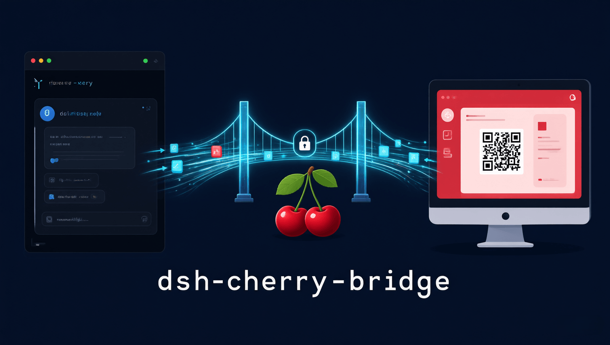
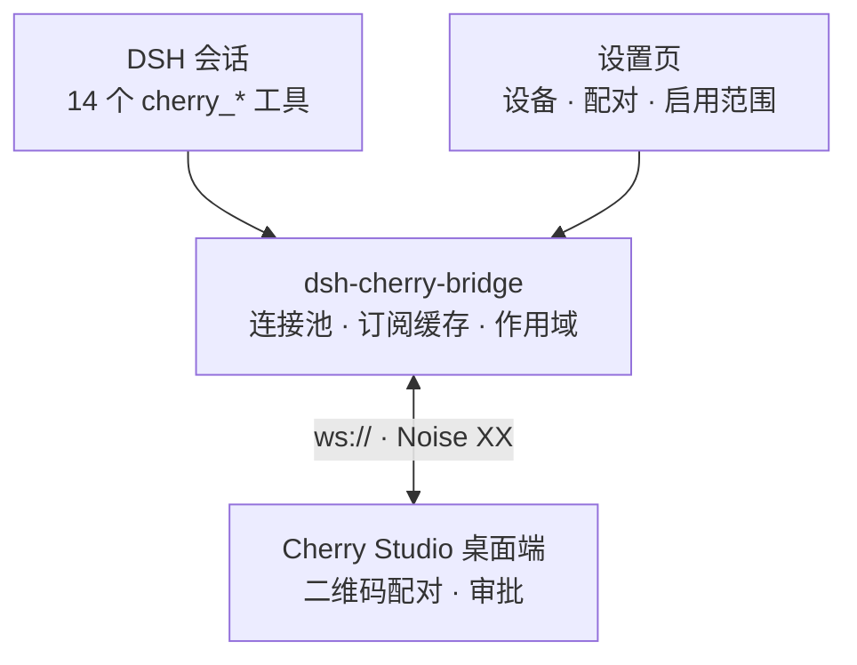

<div align="center">

[English](README.en.md) | **简体中文**

</div>

<div align="center">



</div>

# dsh-cherry-bridge

**把 DeepSeek Harness 桥接到 Cherry Studio 桌面端** — DSH 插件

在 DSH 会话里直接驱动局域网内 Cherry Studio 的 agent：配对、列设备/会话、读历史、
发消息并等待终态、应答审批与提问卡、取消执行；附一个同源设置页管理设备与工具启用范围。



- 包名：`dsh-cherry-bridge`，插件 id：`cherry-remote`
- 传输：`ws://` + Noise XX（加密由 Noise 记录层提供，不依赖 TLS 终止）
- 工具面：14 个 `cherry_*` 工具，**按工作区**启用，默认**谁都没有**（见「启用范围」）
- 设置页与 HTTP 面：宿主 Web 服务器上的同源前缀 `/cherry-remote/api`

## 安装

> **DSH 版本需求**：`>=0.2.0-rc.2 <0.3.0-0`（由 `package.json` 的 `engines.dsh` 声明；不满足时 bundle 被跳过、设置页里该插件的行被禁用，确需在区间外使用可用 `dsh plugin allow-version` 精确豁免。0.3.0 需重新评估兼容性后再放开）。

```bash
# 从 npm 安装（推荐，钉住版本）
npx @deepseek-ai/dsh plugin --profile web add dsh-cherry-bridge@0.1.9

# 安装 npm 最新发布版
npx @deepseek-ai/dsh plugin --profile web add dsh-cherry-bridge

# 从 GitHub 源码安装（与 npm 发布同一提交）
npx @deepseek-ai/dsh plugin --profile web add github:SAXEM1997/dsh-cherry-bridge#v0.1.9
```

本包自带 `cordis.patch.yml`（`package.json` 的 `dsh.bundle.patch` 指向它），
dsh-plugin-manager 据此自动插入插件行。手工加行等价于：

```yaml
- id: cherry-remote
  name: 'dsh-cherry-bridge'
  config:
    perSessionCacheBytes: 2097152
    rateBudgetPerSecond: 32
```

### 首次配对

1. 在 Cherry Studio 桌面端打开 **remote access → 添加设备**：该界面显示**二维码**，
   配对信息要点开扫码后的页面才看得到。
2. **扫这个二维码**（微信、浏览器等均可），复制页面上显示的配对信息。
3. 在 DSH 里调用 `cherry_pair`（设置页向导亦可），粘贴这段配对信息。
4. **双向核对 6 位验证码**：与桌面端显示的数字人工比对一致后再在桌面端批准。
5. 批准后设备档案写入数据目录（`devices.json`，`0600`），其 `desktopIdentity` 被 pin 住，
   此后每次连接都校验 Noise 对端静态公钥与 pin 一致，防二维码被劫持后的中间人替换。

## 快速上手

```text
cherry_pair → 粘贴扫码页的配对信息，核对 6 位验证码
cherry_devices → 看设备与连接状态（前缀即可选中，如 "dev-A"）
cherry_agents → 列设备上的 agent，拿 agentId
cherry_sessions → 列某 agent 的会话，拿 sessionId
cherry_read → 读会话历史（默认取最新 100 条，从新到旧）
cherry_send → 发消息并等待终态，返回助手文本
cherry_interactions → 看待答的提问/审批卡；cherry_respond 作答
```

## 配置

| 键 | 类型 | 默认 | 说明 |
| --- | --- | --- | --- |
| `dataDir` | string | `$DSH_HOME/cherry-remote`（回退 `~/.dsh/cherry-remote`） | 插件数据目录，存放 `identity.key` 与 `devices.json`（均 `0600`）。 |
| `perSessionCacheBytes` | number | `2097152`（2 MiB） | 每个会话的**本地**订阅事件缓存上限，超出按 LRU 丢弃最旧事件并 `warn`。 |
| `rateBudgetPerSecond` | number | `32` | 每设备平滑请求预算（请求/秒）。桌面端共享额度在 ≤2.1.6 是 64 req/s、≥2.1.7 是 256 req/s，且只有新版本才把超限降级为单请求 `RATE_LIMITED`（旧版本直接 close `1011` 终止会话），故按更严格的一代取保守值。 |

> ⚠️ `cordis.patch.yml` 的 `config` 是**整体替换**，不与默认值合并。删掉一个键得到的是
> 插件默认值；键存在但值非法（`0`、负数、字符串）会按名 `warn` 后回落默认值。

## 工具

| 工具 | 作用 |
| --- | --- |
| `cherry_devices` | 列出已配对设备及连接状态（`connected`/`connecting`/`offline`/`disabled`/`identity-mismatch`）。 |
| `cherry_agents` | 列出某设备上可用的 agent（分页）。被截断时必带 `truncated`+`truncationReason`（`limit` 或 `safety-bound`，后者是 1000 条内部上限）；停点可命名时还给出 `resumeCursor`——用同一 device 与过滤条件把它回传为 `cursor` 即可从停点继续（此时 `limit` 约束的是下一次回答）；跨工具/设备/过滤条件的令牌会被**本地拒绝**，不会转发给对端。 |
| `cherry_workspaces` | 列出某 agent 的**已注册**工作区，以及是否存在系统工作区。被截断时必带 `truncated`+`truncationReason`；停点可命名时还给出 `resumeCursor`——用相同过滤条件回传为 `cursor` 即可续读。 |
| `cherry_sessions` | 列出某 agent 的会话，可按工作区过滤。被截断时必带 `truncated`+`truncationReason`（`limit` 或 `safety-bound`），停点可命名时还给出 `resumeCursor`——用同一 device 与**相同过滤条件**把它回传为 `cursor` 即可从停点继续（此时 `limit` 约束的是下一次回答）；跨工具/设备/过滤条件的令牌会被**本地拒绝**。 |
| `cherry_read` | 读会话消息历史快照，**从新到旧**返回（`limit` 丢掉的是**最旧**的消息）。失败消息在桌面端给出时附带 `failure: {reasonCode, retryable, message}`（对端分类、是否值得重试、对端自己的有界摘要；其 `source`/`context` 不投影到回答里）。附件 part 只回 `name`/`mediaType`/`byteLength`，`content` 为空——字节不取。被截断时 `truncated` + `truncationReason` 一定说明：`limit` 表示你设的条数到了，提高 `limit` 即可；`aggregate-bytes` 表示单次回答达到了**输出大小上限**——与 `limit` 无关，提高 `limit` 只会多付往返、仍停在同一预算。**被挡下的更旧消息用 `messagesResumeCursor` 续读**：把本次返回的 `messagesResumeCursor` 原样传给下一次调用的 `messagesResumeCursor` 参数即可从停点继续（`limit` 此时约束的是**从停点起**本次最多返回多少条），长历史分几次回答读完。停点不可命名时**没有**这个令牌（`truncated` 仍为 `true`，**缺失本身不代表历史已到底**；补救按 `truncationReason` 分：`limit` 可以提高 `limit`，`aggregate-bytes` 不行——被挡住的旧消息在这一回答里拿不到，详见[错误与限制](#错误与限制)）。两种令牌：`cursor:<peer position>`（整窗读完后的 peer 分页位置）与 `after:<messageId>`（停在窗内，续读从最新端扫到该消息、返回它更旧的那些）。不是本工具发出的令牌会被**本地拒绝**（不转发给桌面端——桌面端会静默回退到最新页）；`after:` 锚点在历史里找不到则**报错**，不会返回空结果。 |
| `cherry_events` | 读取该会话缓冲区内比 `cursor` 更新的事件，并在投递后 ack。返回 `{events, nextCursor}`；把 `nextCursor` 作为下次的 `cursor` 传回即可续读。 |
| `cherry_create` | 在 agent 工作区创建会话（工作区选择**必填**；创建后回读身份）。 |
| `cherry_send` | 向会话发消息，默认等待运行到终态并返回助手文本；`wait: false` 立即返回命令回执。内容被截断时 `messagesTruncated`/`messagesTruncationReason` 说的是**消息**被截断（丢更旧的）；`deadline` 表示**回答自身的装配时限**到了（见下），已读到的内容照常返回。 |
| `cherry_wait` | 只等待该会话在途执行收敛（不发送新消息）。 |
| `cherry_interactions` | 列出该会话**待答**的交互卡（提问 / 审批）。被截断时必带 `truncated`+`truncationReason`；停点可命名时还给出 `resumeCursor`——用 `sessionId` 相同的调用回传为 `cursor` 即可续读（`limit` 计的是过滤**前**的对端条目）。 |
| `cherry_respond` | 应答交互卡：提问必须全量作答，审批走 `decision`。 |
| `cherry_cancel` | 取消会话在途执行（`expectedExecutionId` 必填）。 |
| `cherry_pair` | 用「扫码后页面显示的配对信息」建立与桌面端的配对。 |
| `cherry_unpair` | 解除配对：断开连接并从设备档案删除。 |

`device` 参数接受**精确 `deviceId`**，或 **`deviceId` 前缀 / 显示名前缀**；多项命中返回
`ambiguous-device` + `candidates`，一个都没命中返回 `not-found` + `known`。

`cherry_send(wait: true)` / `cherry_wait` 的 `status` 有 **8 个取值**：四个协议终态
（`completed`/`failed`/`cancelled`/`interrupted`），加上 `awaiting-interaction`（出现待答
交互卡，运行仍活着）、`timeout`（窗口用尽，**不是失败**，随附部分内容，停点可命名时再带游标）、
`idle`（`cherry_wait` 遇到没有在途执行的会话，立即返回快照）、`subscription-lost`
（事件订阅丢失且重建失败，运行结局**不可知**，随附修复指引）。

## 错误与限制

- 读方法在重连后**单次**重放；桌面端 ≥2.1.7 的限流拒绝（`RATE_LIMITED` + `retryAfterMs`）
  也在调用方预算内等待后**单次**重放。**命令永不重放**——写操作丢失应答时，携**原 `commandId`**
  重试即可，桌面端的命令账本会回放原回执。
- 单个外置内容上限 32 MiB，超过的 part 标 `unavailable`，不回无法校验的部分内容。
- **外置内容装配是进程级限流的**：同时最多 4 个 `{ref}` 在装配（官方客户端的读并发策略）。
  单个 ref 的装配峰值约 3× 它的大小，所以**装配峰值**上界是 4×3×32 MiB = 384 MiB，日常远低于此
  （4×3×声明大小）。它约束的是**正在装配**的内容，不是全部驻留：已经装配完、被各调用自己持有的内容
  不在这个乘积里（每次并发读最多再带一整条消息，因为输出预算只在消息之间检查），parts 缓存另计。
  等待槽位也计入等待类回答的时限：排到时限就放弃并把这一 part 标 `unavailable`。
- 历史走查被截断时一定说明（`truncationReason`，`limit` / `aggregate-bytes` / `deadline` 三种含义不同，见上），
  并在停点可命名时给出 `messagesResumeCursor` 续读令牌。**停点不可命名时就不给**：对端位置为空、
  带首尾空白或任意控制字符、形如已停用的 v1 令牌、令牌会超过 4096 字符上限、或没有可当锚点的
  消息 id——此时 `truncated` 仍为 `true`，**缺失本身不代表历史已到底**。补救按 `truncationReason`
  分：`limit` 停点只有在调用方自己握着上限时才靠更宽的 `limit`（`cherry_read` 与四个列表工具）；
  **wait 类回答的 `limit` 是它自己的固定条数额度**，更旧的历史要用 `cherry_read` 去读。
  `aggregate-bytes` 停点不行——预算是它停下的原因，更宽的 `limit` 只会多付往返，被挡住的旧消息
  在这一回答里拿不到；`safety-bound` 停点是内部熔断，调用方动不了它；`deadline`（只出现在 wait
  类回答）同样改用 `cherry_read` 续读，它没有时限。
  **两个面是同一条规则**：消息面的 `messagesResumeCursor` 与四个列表工具的
  `resumeCursor` 都只发出本工具会收回的令牌；位置内部的普通空格合法，不会因此被拒。
  某条消息自身 parts 没读全时带 `incomplete: true`（wait 类回答里被时限截断的那条消息会带 `partsTruncated: "deadline"`）。
- **等待类回答有自己的装配时限**：`cherry_send(wait: true)` / `cherry_wait` 在窗口结束后仍要读一段历史
  （消息页 + 每条消息的 parts + 每个外置 `{ref}` 内容），这一步现在是**有时限的**——截至「你的窗口 +
  同样长度的时间」，下限 1 秒、上限 15 秒（即窗口 1 秒 → 最多再等 1 秒；窗口 20 秒 → 最多再等 15 秒）。
  链路抖动时不会再有「每个请求各等 5 秒重连」把回答拖到几分钟之后；时限用尽就停走查，
  已读到的内容照常返回并标 `messagesTruncationReason: "deadline"`，更旧的历史用 `cherry_read` 续读。
  同一条时限也覆盖 **终态与超时回答**所读的会话快照：快照读不到时
  回执降级（`aggregateError` + `guidance`），不会把已经确定的运行结局（`status` 与各 id）一起丢掉。
  `cherry_wait` 判断「会话是否还有在途执行」的那次**前置快照**同样有时限（从工具入口起算「窗口 + 尾」）：
  它在预算内读不到时直接**失败并给出修复指引**——此时还没有回答可降级，运行状态**不可知**，重试是恢复路径；
  「500 毫秒窗口却先等 5–10 秒重连与重放」的旧形态因此消失（#51）。前置快照成功之后，
  idle 回答的历史走查仍从那一刻起算自己的预算（慢但成功的快照不会把走查挤成零）；
  代价是两段预算**分开计**，病态调用可能把两段都花掉。
- **已知限制**：`cherry_respond` 让 DSH agent 可代替用户批准 Cherry 端审批卡（MVP 不加拦截层，
  信任 DSH 自身的工具审批）；每设备仅申请 `agent` capability；仅 `ws://`（Noise 加密），不做 TLS 直连。

> 传输重放、32 MiB/≈3× 内存、空页与游标容忍、完整性语义等工程细节见 [`AGENTS.md`](AGENTS.md)。

## 设置页与启用范围

插件同时是 **web client bundle**（`package.json` 的 `dsh.client`，导出 `./client`），通过
`settings.section` 槽位注册 **`cherry-remote`**（导航标签「Cherry 互联」）页面：
设备卡片（启用/停用/删除）、配对向导（粘贴 → 6 位验证码 → 终态）、启用范围面板，以及经
`/cherry-remote/api/events` SSE 推送的实时状态。

14 个工具**按工作区**决定是否出现，机制是**隐藏而非拒绝**（不在范围的会话里不进工具表，省上下文）：

- **默认谁都没有**：作用域文档不存在、损坏或读不出来，都按 `selected` + 空列表处理（fail-closed）。
- **`仅选定工作区`**：只有勾选的工作区里的会话才可能出现这些工具；没有工作区的会话始终没有。
- **`全局`**：所有工作区都可见，面板勾选不参与判定。
- **保存即时生效**：对所有 live agent 重装/释放限制层，**下一轮**即生效，无需重启或新建会话。
- **范围只管工具**：设置页与 `/cherry-remote/api` 不受范围影响，被排除的工作区也能自救。
- **不假装**：宿主能力 `pending` / `unsupported` 时面板如实说明，这些工具都**不注册**（fail-closed）。

开发时可单独跑 `npm run dev:ui`，前提是宿主已在 `http://127.0.0.1:23023` 运行；
`CHERRY_DEV_HOST=http://127.0.0.1:<port>` 可改端口。作用域文档在 `<dataDir>/scope.json`
（`0600`、原子写入、`revision` 单调），HTTP 端点与错误码见 [`AGENTS.md`](AGENTS.md)。

## 开发

```bash
npm test               # vitest 全量（含 tests/contract/）
npm run typecheck      # 服务端 + UI 两侧
npm run build          # tsdown → dist/index.mjs + dist/index.d.mts
npm run build:client   # vite → lib/client.js
npm run dev:ui         # 设置页 dev server（需宿主在 127.0.0.1:23023 运行）
npm run prepublishOnly # 发布前闸门：typecheck + test + build + build:client + npm pack --dry-run
```

`dist/` 与 `lib/` 是**随仓库提交**的产物：改完 `src/` 或 `ui/` 必须重跑
`npm run build && npm run build:client` 再提交。开发约定、构建事实、协议依据与设计决策见
[`AGENTS.md`](AGENTS.md)；发布前请走完 [`docs/e2e-checklist.md`](docs/e2e-checklist.md)
（配对 / 发送 / 交互应答 / 断连恢复 / 多设备并存需真机人工核验）。

## License

MIT
