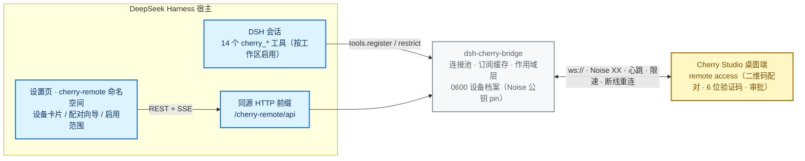

<div align="center">

[English](README.en.md) | **简体中文**

</div>

# dsh-cherry-bridge

**把 DeepSeek Harness 桥接到 Cherry Studio 桌面端** — DSH 插件

在 DSH 会话里直接驱动局域网内 Cherry Studio 的 agent：配对、列设备/会话、读历史、
发消息并等待终态、应答审批与提问卡、取消执行；附一个同源设置页管理设备与工具启用范围。



- 包名：`dsh-cherry-bridge`
- 插件 id：`cherry-remote`（呼应协议发现类型 `remoteDiscoveryType` 的 mDNS 服务标识）
- 传输：`ws://` + Noise XX（加密由 Noise 记录层提供，不依赖 TLS 终止）
- 工具面：14 个 `cherry_*` 工具
- 启用范围：这 14 个工具**按工作区**启用，默认**谁都没有**（见下文「启用范围」）
- HTTP 面：宿主 Web 服务器上的同源前缀 `/cherry-remote/api`

## 安装

```bash
# 从 GitHub 安装（推荐）
npx @deepseek-ai/dsh plugin --profile web add github:SAXEM1997/dsh-cherry-bridge

# 钉住版本标签（生产推荐）
npx @deepseek-ai/dsh plugin --profile web add github:SAXEM1997/dsh-cherry-bridge#v0.1.0
```

```bash
# 或从 npm registry 安装
dsh plugin --profile <name> add dsh-cherry-bridge
```

或以 bundle patch 方式合入 profile —— 本包自带 `cordis.patch.yml`，其中已声明插入行
`cherry-remote` 与默认配置（见下文「配置」）。`package.json` 的
`dsh.bundle.patch` 指向该文件，dsh-plugin-manager 据此自动插入插件行。

profile 手工加行等价于：

```yaml
- id: cherry-remote
  name: 'dsh-cherry-bridge'
  config:
    perSessionCacheBytes: 2097152
    rateBudgetPerSecond: 32
```

### 首次配对

1. 在 Cherry Studio 桌面端打开 **remote access → 添加设备**：该界面显示的是**二维码**，
   配对信息（地址、端口与一次性邀请）要点开扫码后的页面才看得到。
2. **扫这个二维码**（微信、浏览器等均可），把扫码后页面上显示的配对信息复制下来。
3. 在 DSH 里调用 `cherry_pair`（设置页向导亦可），粘贴这段配对信息。
4. **双向核对 6 位验证码**：`cherry_pair` 结果与设置页都会醒目展示该代码，请与桌面端
   显示的数字人工比对一致后再在桌面端批准。
5. 批准后设备档案写入插件数据目录（`devices.json`，权限 `0600`），其
   `desktopIdentity` 被 pin 住；此后每次连接都校验 Noise 对端静态公钥与 pin 一致，
   防止二维码被劫持后的中间人替换。

## 配置

| 键 | 类型 | 默认 | 说明 |
| --- | --- | --- | --- |
| `dataDir` | string | `$DSH_HOME/cherry-remote`（回退 `~/.dsh/cherry-remote`） | 插件数据目录，存放 `identity.key` 与 `devices.json`（均 `0600`）。 |
| `perSessionCacheBytes` | number | `2097152`（2 MiB） | 每个会话的**本地**订阅事件缓存字节上限。超出时按 LRU 丢弃最旧事件并 `warn` 记录。 |
| `rateBudgetPerSecond` | number | `32` | 每设备二级平滑请求预算（请求/秒）。桌面端实现的硬上限是 64 req/s 且**无协商通道**（2.1.5 起 `agent.content.read` 另有 512 req/s 的独立窗口），超限会以 close `1011` 终止整条会话；这里取保守值。 |

> ⚠️ `cordis.patch.yml` 的 `config` 是**整体替换**，不与 bundle 默认值合并。装配层
> （`resolveBridgeConfig`）对缺键回落上述默认值——因此删掉一个键得到的是**插件默认
> 值**，不是 profile 里别处的值。缺键与非法值是两回事：键存在但不可用（`0`、负数、
> 字符串）会按名 `warn` 后回落。

## 工具

| 工具 | 作用 |
| --- | --- |
| `cherry_devices` | 列出所有已配对设备及其连接状态（`connected`/`connecting`/`offline`/`disabled`/`identity-mismatch`）。 |
| `cherry_agents` | 列出某设备上可用的 agent（分页）。 |
| `cherry_workspaces` | 列出某 agent 的**已注册**工作区，以及是否存在系统工作区。 |
| `cherry_sessions` | 列出某 agent 的会话，可按工作区过滤。 |
| `cherry_read` | 读取会话的消息历史快照（两级基线：`agent.sessions.get` + `agent.messages.list`/`agent.parts.list`；parts 按**每条消息自身**的 revision 读取）。附件部件只回 `name`/`mediaType`/`byteLength` 与**空** `content`——字节不取。 |
| `cherry_events` | 读取该会话缓冲区内比 `cursor` 更新的事件，并在投递后 ack。 |
| `cherry_create` | 在 agent 工作区创建会话（工作区选择**必填**；创建后经 `agent.sessions.get` 回读身份）。 |
| `cherry_send` | 向会话发消息，默认等待运行到终态并返回助手文本；`wait: false` 立即返回命令回执。 |
| `cherry_wait` | 只等待该会话在途执行收敛（不发送新消息）。 |
| `cherry_interactions` | 列出该会话**待答**的交互卡（提问 / 审批）。 |
| `cherry_respond` | 应答交互卡：提问必须全量作答，审批走 `decision`。 |
| `cherry_cancel` | 取消会话在途执行（`expectedExecutionId` 必填）。 |
| `cherry_pair` | 用「扫码后页面显示的配对信息」建立与桌面端的配对。 |
| `cherry_unpair` | 解除配对：断开连接并从设备档案删除。 |

设备选择器（`device` 参数）接受**精确 `deviceId`** 或**唯一的显示名前缀**；前缀命中
多项时返回结构化歧义错误，不会任选一个。

`cherry_send(wait: true)` / `cherry_wait` 返回的 `status` 有 **8 个取值**：四个协议终态
（`completed`/`failed`/`cancelled`/`interrupted`）之外，还有四个 waiter 自己的判定——
`awaiting-interaction`（软终态：出现待答交互卡，运行仍活着）、`timeout`（窗口用尽，
**不是失败**，返回已到达的部分内容与续读游标）、`idle`（`cherry_wait` 遇到没有在途执行
的会话，立即返回当前快照）、`subscription-lost`（等待途中事件订阅丢失且重建失败，运行
结局从此处**不可知**：与 `timeout` 不同，随附修复订阅／按 id 回读运行的指引）。

## 设置页（web client）

插件同时是一个 **web client bundle**（`package.json` 的 `dsh.client` 声明
`platform: web`，导出 `./client`）。它通过宿主设置页的 `settings.section` 槽位注册
一个 **`cherry-remote`** 命名空间页面，提供：

- 设备卡片列表：显示名、地址、连接状态灯、启用/停用、删除；
- 配对向导：粘贴扫码页显示的配对信息 → 展示 6 位验证码 → 展示终态；
- 启用范围面板：`全局` / `仅选定工作区` 二选一 + 工作区多选（标题 + 路径），见下文「启用范围」；
- 实时状态：设备状态与配对进度经同源 SSE 流（`/cherry-remote/api/events`）推送。

开发时可单独跑 `npm run dev:ui`（`ui/` 下的 Vite 入口）。**前提是同一个 DSH 宿主已在
`http://127.0.0.1:23023` 运行**：该 dev server 只服务页面本身，页面调用的
`/cherry-remote/api` 由 `ui/vite.config.ts` 里的 **dev-only 代理**转发到宿主（SSE 也走
同一条代理，不被缓冲）。没有宿主时页面能渲染，但设备列表与事件流会报错。宿主在别的
端口时用 `CHERRY_DEV_HOST=http://127.0.0.1:<port> npm run dev:ui` 覆盖，不必改代码。

## 启用范围

14 个 `cherry_*` 工具**按工作区**决定是否出现，而不是在每个会话里都注册一遍。设置页的
**「启用范围」**面板（命名空间 `cherry-remote`，导航标签「Cherry Studio 互联」）负责编辑它。
机制是**隐藏而非拒绝**：不在范围的会话里，这些工具**不进工具表**（省上下文），而不是「看得见、
调用才报错」。

- **默认谁都没有**：作用域文档不存在时按 `selected` + **空列表**处理——**没有任何工作区**拿到
  这些工具。这是 fail-closed 的一侧：文档损坏 / 字段非法 / 读不出来同样落到更严的一侧，
  **不存在**「读不出来就当全局」的退路。
- **`仅选定工作区`（`selected`）**：只有勾选的工作区里的会话才可能出现这些工具；**没有工作区**
  的会话（`cwd` 不属于任何已注册工作区）则始终没有（fail-closed）。
- **`全局`（`global`）**：所有工作区都可见；此时面板上的勾选**不参与判定**（切回 `selected`
  后才生效）。
- **保存即时生效，含进行中的会话**：保存成功后对**所有 live agent** 重装 / 释放限制层，
  **下一轮**即生效——不需要重启 DSH，也不需要新建会话；取消勾选同样在下一轮消失。
- **范围只管工具**：设置页与 `/cherry-remote/api` **不受**范围影响——被排除的工作区也必须能自救
  （配对、改范围）。
- **能力不足时不假装**：`host.state` 为 `pending`（注入回调尚未到达）时面板只给**中性等待**提示，
  **不**禁用保存；为 `unsupported`（`tools.register` / `tools.restrict` / `tools.schemas` 任一
  静态能力缺失）时给只读告警、按**真实缺因**说明并**禁用保存**。两种状态下这些工具都**不注册**
  （fail-closed），绝不退回「全局可见」。

> **文案边界**：面板只声称「**本插件未遮蔽**这些工具」。上游 `allow` 型过滤（例如子代理的
> `toolFilter`）仍可能让某个会话看不到它们——那是接受的行为，本插件不对上层过滤的结果作保证。

### 作用域文档与端点

作用域文档落在插件数据目录：`<dataDir>/scope.json`（默认 `$DSH_HOME/cherry-remote/scope.json`），
权限 `0600`、原子写入、`revision` 单调递增——**唯一的例外**是文档解析失败或字段非法：此时按更严的
一侧（`selected` + 空列表）重建并**把 `revision` 归 0**，文档仍可被正常写入覆盖；它**不进**
profile YAML（避免双真相源）。

`GET /cherry-remote/api/scope` 一次返回整份状态：

```json
{
  "scope": { "mode": "selected", "workspaceIds": [], "revision": 0 },
  "workspaces": [{ "id": "…", "title": "…", "path": "…" }],
  "staleWorkspaceIds": [],
  "pathUnmatched": [{ "agentId": "…", "cwd": "…" }],
  "host": { "state": "ready", "capable": true, "reason": "…", "degraded": [] }
}
```

- `scope` —— 文档的三个可写字段（`mode` / `workspaceIds` / `revision`）。
- `workspaces` —— 注册表里的工作区（只投影 `id`/`title`/`path`；浏览器够不到注册表本身）。
- `staleWorkspaceIds` —— 文档里勾选、但注册表已不存在的 id：**由 `PUT` 修剪是清除它们的唯一
  路径**，界面据 `pruned` 回显清除结果，而**不是**报「校验失败」。
- `pathUnmatched` —— **cwd 与当前一代的规范路径表不匹配**的会话（`agentId` + `cwd`）。两类都记在
  这里：解析成功、但规范化（realpath）后不属于任何已注册工作区的 cwd（拼写不同 / 符号链接 / 该
  目录确实未注册，三者在此不可区分）；以及宿主没有 `resolveByPath`（见下面 `path-normalization`
  一条）时，只按大小写敏感字符串等价比对而没命中的 cwd。
  它们按「无工作区」处理：**`selected` 模式下**这些会话看不到这 14 个工具；`global` 模式下一切照常
  可见（不看工作区登记），所以这条只在 `selected` 下解释「勾了却无工具」的原因；它**不是**降级，
  也不改动勾选或 `mode`、不触发写入。
- `host` —— 能力三态（`pending` / `unsupported` / `ready`，`capable === (state === 'ready')`）
  与 `degraded` 数组（`{source, reason}`；同一来源只留最新一条，不同来源并存）。五个来源各自是：
  - `install` —— 隐藏层的应用失败过；`reason` 说明是四处里的哪一处：无参 `schemas()` 读不到
    （本轮既不装也不释放任何层）、某层的释放抛错（旧层可能仍在生效）、agent 缺
    `agent.ctx.tools.restrict`、宿主拒绝了 `restrict()`。它**只累积、不被任何成功路径清除**
    （同来源被后一条覆盖），所以恢复之后它仍然只表示「本次会话中曾失败过一次」。
  - `workspace-list` —— 工作区注册表读不到（读取失败或返回空表）：判定 fail-closed、写侧拒绝；
    这是五个来源里**唯一**会在下一次成功读取时被清掉的一个。
  - `visibility-only` —— 宿主没有 `tools.guard`，或安装它时被拒：`restrict` 仍在装配层移除这 14 个
    工具（不是渲染层假过滤），但**执行侧兜底**没了——没有任何一层会拒绝这些工具的调用，只算
    **可见性**降级、不是执行边界。若某个 agent 连 `restrict` 也装不上（同一条 `install` 来源的
    另一处），那个 agent 的目标工具保持可见、guard 也放行：插件隐藏不了它，只能把这件事记在
    `degraded` 里。
  - `scope-version` —— 文档的 `version` 与本插件支持的不一致（高于或低于皆同一条守卫）：只读降级
    并锁死写入（避免覆写不同格式的文档）。
  - `path-normalization` —— 宿主没有 `resolveByPath`：cwd 比对退化为大小写敏感字符串等价（不做
    realpath），符号链接或拼写差异下规则二可能不命中。

`PUT /cherry-remote/api/scope` 是读-改-写：body 为 `{mode, workspaceIds, expectedRevision}`，
`expectedRevision` **必填**，就是上一次读到的 `revision`。成功返回 `200 {scope, pruned}`：
`scope` 是写入后的规范文档（被修剪的 id 已不在其中），`pruned` 是这次被修剪掉的已失效 id，返回的
新 `revision` 就是下一次写入的基准。失败返回 `{error, message?}`，`error` 是稳定码：

| HTTP | `error` | 含义 |
| --- | --- | --- |
| 400 | `invalid-scope` | 字段非法：`mode` 不是 `global`/`selected`，或 `workspaceIds` 不是字符串数组。 |
| 400 | `missing-expected-revision` | 请求没带基准 `expectedRevision`，**或它不是有限数字**（类型/取值都由同一条守卫判定）。 |
| 409 | `scope-revision-conflict` | 基准 `revision` 已过期（配置被他处改过）；`message` 内含当前 `revision`。 |
| 503 | `workspace-list-unavailable` | 工作区注册表读不到：拒绝写入，已存勾选与 `mode` **一位不动**（也不修剪）。 |
| 503 | `scope-version-unsupported` | 作用域文档的 `version` 与本插件支持的**不一致**（高于或低于都会命中同一条守卫）：只读降级；**重读仍是同一份文档**。 |

> 请求体**整个**读不出来（非法 JSON）时仍走本模块既有的 `400 invalid-request`——那不是作用域
> 字段的裁决，故不在上表内。

## HTTP 面（同源）

挂载在宿主 Web 服务器的 `/cherry-remote/api` 前缀下，**不新增独立监听、不暴露局域网、
不设独立凭据**：

| 方法与路径 | 作用 |
| --- | --- |
| `GET /cherry-remote/api/devices` | 设备列表。 |
| `PATCH /cherry-remote/api/devices/:id` | 改显示名/启用状态/地址/端口（`hosts` 为**整体替换**）。 |
| `DELETE /cherry-remote/api/devices/:id` | 移除设备并断开其连接。 |
| `GET /cherry-remote/api/scope` | 启用范围：作用域文档 + 注册表工作区列表 + `host` 诊断（见「启用范围」）。 |
| `PUT /cherry-remote/api/scope` | 保存启用范围（读-改-写，`expectedRevision` 必填）。 |
| `POST /cherry-remote/api/pair` | 启动一次配对，立即返回 `202 {claimId}`，进度走 SSE。 |
| `GET /cherry-remote/api/events` | SSE：`device-state` / `pairing-progress`（`pairing-progress` 每帧带产生它的 `claimId`；心跳为无载荷注释行）。 |
| `GET /cherry-remote/api/diagnostics` | 运维诊断报告（见下）。 |

> `pairing-progress` 帧的最小形状是 `{stage, detail?}`；本插件在其上**额外**附带可选的
> `claimId`（跨 run 隔离用的裁定扩展，非计划内最小字段），消费方须容忍该字段缺失。

**信任 fence**：每个路由在动手前都自行过一遍同源判定，四分支按序为
(1) 非回环且未声明的 `Host` → 拒绝；(2) `sec-fetch-site: cross-site` → 拒绝；
(3) 附带 `Origin` 与 `Host` 非同源 → 拒绝；(4) **`Origin` 缺失 → 放行**（那是
curl 之类的非浏览器客户端，不是跨站页面）。

### `GET /diagnostics`

汇总设备状态 / 连接统计 / 最近错误摘要，**并按 §5 脱敏规则处理**：

- 可出：`deviceId`、显示名、状态、地址、端口、`desktopIdentity` 的 **12 位摘要**、
  **hello 协商后的有效 limits**（`heartbeatMs`/`subscriptions`/`pageItems`/
  `inFlightRequests`；**只有存在活连接时才报**——本端点从不拨号，无连接的设备既不报
  limits、也不会被顺手唤醒，而不是拿客户端回退值冒充）、
  `sessionId` 与会话游标（游标取自订阅层当前状态，未订阅的会话没有该字段）、
  `stats` 计数器（`connections`/`sockets`/`connectionsBuilt`/`subscriptions`）、
  装配层解析出的**两个 `config` 键**
  （`rateBudgetPerSecond`/`perSessionCacheBytes`，与日志里报的是同一组数字）、
  错误的 reason/message（**message 在端点边界被截断到 200 字符**，
  见 `ERROR_MESSAGE_MAX`）；
- 绝不出：`accessToken`、`tokenExpiresAt`、`invitationSecret`、原始
  `desktopIdentity`、消息文本与 part 文本。

> `stats.connectionsBuilt` 是**连接池自上次 `apply` 以来构建过的连接数**，
> 不是 RPC 请求量——请求计数归传输层所有，本端点不发布同名指标以免误读。
> 计数器与错误环都在每次 `apply` 时清零：统计只描述**当前**这次装配。

脱敏是**白名单投影**而非黑名单过滤：报告是逐字段新建的对象，因此日后往设备档案里
新增的凭据字段会**按构造**被排除，而不依赖有人记得去更新一份拒绝清单。

## 日志

分级约定（spec §5）：

- **error** —— 连接失败 / 认证失败 / 协议错误；
- **warn** —— 重连退避 / 缓存淘汰 / 订阅 LRU 驱逐；
- **info** —— 配对进度 / 订阅建立与恢复 / 设备状态迁移。

info 级只记**阶段名与标识符**（`deviceId`/`sessionId`/配对阶段），不记任何载荷。

敏感字段（token、`invitationSecret`、`accessToken`、消息内容与 part 文本）**一律不入
日志**；`deviceId`、`desktopIdentity` 摘要与 `sessionId` 可记。契约套件对一条完整的
配对→连接→发送→交互流程做了日志脱敏断言（`tests/contract/contract.test.ts`）。

## 开发

```bash
npm test            # vitest 全量（含 tests/contract/）
npm run typecheck   # 服务端 + UI 两侧
npm run build       # tsdown → dist/index.mjs + dist/index.d.mts
npm run build:client # vite → lib/client.js
npm run dev:ui      # 设置页 dev server（需宿主在 127.0.0.1:23023 运行，见上）
npm run prepublishOnly # 发布前闸门：typecheck + test + build + build:client
```

> **`dist/` 与 `lib/` 是随仓库提交的构建产物，不是 gitignore 的输出。** 改完 `src/`
> 或 `ui/` 后必须重跑 `npm run build && npm run build:client` 再提交，否则提交里的产物
> 就是旧的。这里**没有** `prepare` 钩子：`prepare` 在 `npm install` 时也会跑，而
> `npm install --omit=dev` 会先剪掉 devDependencies，钩子随即因找不到 `tsdown`/`vite`
> 而失败（127）——整个安装被拖挂。产物入库后 git 安装、`--omit=dev`、以及对克隆目录
> 直接打包都无需任何构建步骤即可工作。`tests/contract/contract.test.ts` 里的
> 「clean clone → pack」用例是这条的**闸门**：它克隆本仓库（不带 `node_modules`），断言
> 克隆中**已经**含 `dist/index.mjs`、`dist/index.d.mts`、`lib/client.js`，且
> `npm pack --ignore-scripts` 的 tarball 里也含这三个文件。防止产物悄悄腐坏的是
> `prepublishOnly`：发布路径上它先跑 typecheck 与全量测试、再重建两侧产物。

依赖 `@cherrystudio/remote-protocol@0.5.0` 与 `@cherrystudio/remote-transport@0.2.1`
以**精确版本**固定（无 `^`），并有测试断言锁死——升级时必须重跑
`tests/contract/contract.test.ts` 以防 schema drift。契约套件同时逐条建模了「本仓库
自环假对端」与「真实 Cherry Studio」的**六项行为差异**，并逐条对应
[`docs/e2e-checklist.md`](docs/e2e-checklist.md) 中的人工核验步骤。

### 与 Cherry Studio 版本的对应关系

已验证的桌面端范围是 **2.1.4 → 2.1.6**（含 `main` 上 2.1.6 之后的提交），依据是逐面比对
上游 `src/main/services/remoteAccess/` 与 `packages/remote-{protocol,transport}` 的差异：

| 上游变化 | 影响 |
| --- | --- |
| 2.1.5 起 `connection.hello` 增加 `agentUploadsVersion`/`agentUploadChecksum`/`agentAttachmentSelections` 与 5 个 `agentUpload*` limits | **加法**，无影响：hello 无严格校验，限额按名读取（回归测试：`tests/integration/connection.test.ts` ①c） |
| 2.1.5 起记录分帧引入二进制 marker（首字节 `1`）承载上传块 | **加法**：JSON 记录双向编码未变，本插件既不发也不收二进制 |
| 2.1.5 起附件按 `{kind:'file', name, ref}`（顶层 `ref`）投影，字节可经 `agent.content.read` 取 | 只取**元数据**（`name`/`mediaType`/`byteLength`），**绝不取字节**：读路径是文本通道（`tests/integration/toolsRead.test.ts` ④k/④l） |
| 2.1.5 起 `agent.messages.send` 要求 `text` trim 后非空 | `cherry_send` 对空白正文本地给出 `text-empty`，不上线（`tests/integration/toolsSendGuard.test.ts`） |
| `agent.content.read` 单独放宽到 512 req/s；其余业务方法仍是 64 req/s | 本插件的 32 req/s 预算不变，仍然安全 |
| 2.1.5 起 Linux 无钥匙串时以明文 0600 存设备身份；identity **永不重生成** | 升级**不需要重新配对**；无钥匙串的 Linux 桌面从「不可用」变为「可用」 |

配对 payload、mDNS 广告、协议版本（`[1]`）与 Noise profile 在上游本轮更新中**零改动**。
上游另有 `5db8ab7`（agent runtime 由 DSH 换成 Pi，删除其自带的 `packages/dsh-bridge`）——
那是**反方向**的桥（Cherry 驱动 DSH），与本插件依赖的 remote-access 面无关。

> `zod` 是**运行时**依赖，不是可删的死依赖：本包的 `dist` 把
> `@cherrystudio/remote-protocol` 作为 external，而该协议的运行时产物处处 `import
> zod`（peer `^4.3.4`，协议包自身的 dev pin 已升到 4.4.3，不影响这个区间下界）。把它降级为 devDependency 或移除，
> 都会让协议包在运行时加载 schema 失败。这里精确钉在 `4.3.4`——即 peer 区间下界，
> 也是协议包的测试基线。

> TypeScript 钉在 `~7.0.2`（只放行补丁位）。**已接受的风险**：`tsdown` 生成
> `dist/index.d.mts` 走的是 TS 7 的实验性 dts API，该面在 minor 版本间可能变动；
> 限定为 patch-only 区间意味着 minor 不会在区间内静默改变这个面，升级必须显式改
> `package.json` 并重跑 `npm run build` + 全量测试。类型面的产物随仓库提交，所以一次
> 坏升级会立刻在**逐字节的产物闸门**里现形，而不是等下游消费方撞上：
> `tests/unit/artifactFreshness.test.ts` 按当前源码重建 `dist/index.mjs`、`dist/index.d.mts`
> 与 `lib/client.js`，再与**已提交**的版本逐字节比对（契约套件的「clean clone → pack」用例只
> 断言这三个文件**存在**，看不到字节级的腐坏）。

> 说明：本仓库的 `tests/loopback/fakeCherry.ts` 是**测试内**的自环假对端，不是发布物；
> 文档与代码注释中出现的 `Task N`、`spec §x`、`controller ruling`、`UltraReview` 等编号，
> 指向本项目内部的 SDD 过程文档（设计/任务/审查记录），**不随包发布**——它们只是把
> 「这条规则为什么长这样」的出处留在原处。发布物里 `docs/` 只含
> [`docs/e2e-checklist.md`](docs/e2e-checklist.md)（`files` 逐项列出，未列 `docs` 目录
> 本身），而 `docs/superpowers/**` 的内部过程文档被**有意排除**在 tarball 之外。

> `files` 里的 `src` 与 `ui` 是**有意发布**的：宿主侧排查（对照 `dist`/`lib` 的产物行为
> 读原始实现）与二次开发需要它们；运行时实际解析的是 `exports` 指向的 `dist/*` 与
> `lib/client.js`，`src` 不参与加载。

发布前请走完 `docs/e2e-checklist.md`：Electron 端的人工批准无法 CI 化，真机流程
（配对 / 发送 / 交互应答 / 断连恢复 / 多设备并存）必须人工过一遍。

## 已知限制

- `cherry_respond` 允许 DSH agent 代替用户批准 Cherry 端的审批卡，存在滥用面。MVP
  不再加拦截层，信任 DSH 自身的工具调用审批体系约束 agent 行为；二期可加「审批类应答
  需经 DSH 侧 `ask_user_question` 确认」的 gate。
- 每设备仅申请 `agent` capability，不申请 `configuration`。
- MVP 仅使用 `ws://` 传输（加密由 Noise 记录层提供），不做 TLS 直连。

## License

MIT
